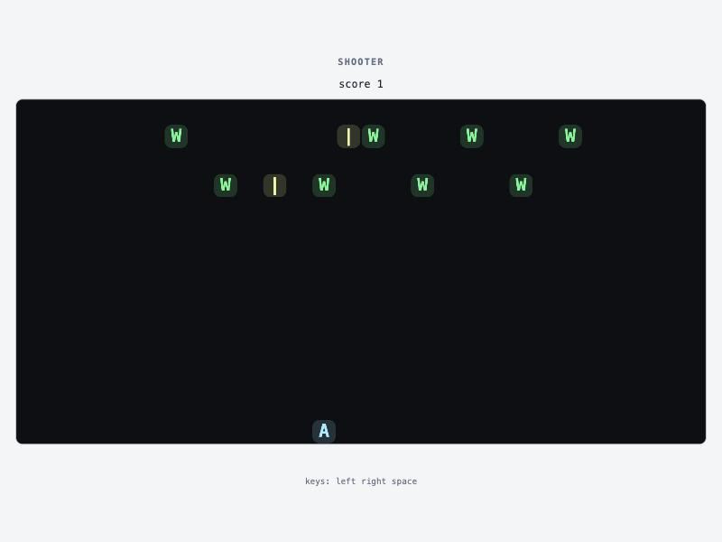

<p align="center">
  <picture>
    <source media="(prefers-color-scheme: dark)" srcset="assets/logo-dark.svg">
    
  </picture>
</p>

<p align="center">
  
  
  <a href="https://github.com/srivtx/intent/actions/workflows/tests.yml"></a>
  
  
  
  
</p>

> **Experimental.** Intent is a research prototype, a day or two old. The language changes
> between versions, there are things it cannot say yet ([limits](#what-this-version-cannot-do)),
> and it is tested on macOS and Linux only. Use it to explore the idea, not to hold data you care about.

**[Website](https://intent.srivtx.xyz)** · **[Language guide](docs/language.md)** · **[Changelog](CHANGELOG.md)** · **[Examples](examples/)** · **[Stress experiments](gemini-build/README.md)**

# Intent

You describe **what information exists and what should be possible with it**, in ordinary
sentences. The compiler works out the data structures, loops and algorithms, and emits
**LLVM IR directly** — no Rust, C or JavaScript in between — which becomes a native program.

No AI is involved. The compiler is deterministic: the same text always means the same thing.

```
Customers is a collection.
Each customer has a name, an age and an email.
Emails are unique.
Reject duplicates.

Add a customer.
Find a customer by email.
Remove a customer by email.
For every customer, double their age.
adults: the names of customers whose age is at least 18.
What is the average age?
Show the customers sorted by age, largest first.
```

Nothing above says array, hash map, loop, index or sort algorithm.

## Try it

Needs Python 3.10+ and `clang`. No packages to install.

```bash
./intent check examples/customers.intent
```

```bash
./intent explain examples/customers.intent
```

```bash
./intent build examples/customers.intent -o build/customers
```

```bash
printf 'add Alice,20,alice@x.com\nadd Bob,25,bob@x.com\ndouble-age\nfind-by-email bob@x.com\naverage-age\n' | ./build/customers
```

```bash
./intent check examples/questions.intent
```

```bash
python3 -m pytest tests -q
```

| command | what it shows |
|---|---|
| `check` | how every sentence was read, and every question the compiler has |
| `explain` | the representation it chose and which lines of your program caused each choice |
| `ir` | the generated LLVM IR (each function is labelled with the sentence it came from) |
| `build` | native executable; it reads one command per line on stdin |
| `run` | the same program in the reference interpreter |

## The three rules that make this work

**1. It never drops a word it does not know.** Every word is either a concept in the
[lexicon](intentc/lexicon.py), filler in the lexicon, or a name your program declared.
Anything else stops compilation and is pointed at. So `So basically, I want to double the
age of all the customers please` compiles, and `Show the largest positive age` does not:

```
error: I don't know the word "positive"
9 | Show the largest positive age.
  |                  ^^^^^^^^ not a concept I know, and not a name this program declared
```

**2. It asks instead of guessing, and points at the words.** Things it asks about today:
a pronoun with no clear referent (`double it`), sorting without a property, removing without
saying which, `by age` (sorted by, or looked up by?), a comparison with no property
(`customers over 25`), mixed `and`/`or`, a property whose type nothing decides, and what
happens when a unique value is added twice.

**3. A program is a service, not a script.** You declare capabilities; the compiled program
accepts them as commands, any number of times in any order. That is what gives the compiler
a real decision to make about representation: it minimises the per-call cost of the
capabilities you declared and builds nothing you did not ask for.

## How flexible is it?

**Different words, different order.** These all compile to `remove customer where age < 18`:

- Remove the customers whose age is under 18.
- Customers whose age is under 18: remove them.
- If the age is under 18, delete the customer.
- Wipe out every customer with an age below 18.

**Spelling slips.** `Shwo teh customres sroted by aeg.` compiles, and says what it did:

```
note: read "Shwo" as "show"
note: read "customres" as "customers"   (and three more)
```

A misspelled word is accepted only when exactly one known word that close makes the *whole
sentence* readable. If two corrections would give different meanings (`coxt` when the
program has both `cost` and `coat`), it asks. A word that is not close to anything
(`positive`) is still an error. Names in declarations are never "corrected".

**Teach it your own words.** The vocabulary is not fixed; a program extends it:

```
"older than" means age over.
An adult is a customer whose age is at least 18.
A senior is an adult older than 64.
An open task is a task whose done is 0.
"oldest" means with the largest age.

Show the names of seniors.          ->  list name of customer where age >= 18 and age > 64
Show the 3 oldest adults.           ->  ... where age >= 18 sorted by age descending, first 3
```

A taught word is substituted before the sentence is read, so it behaves exactly like its
meaning, typos in it are caught the same way, and a word can never be given a second meaning.

**Rankings, ranges, percentages.** `Show the top 3 players by score.`,
`the customer with the lowest age`, `whose age is between 18 and 30`,
`Increase every salary by 10 percent.`, `Remove all customers.`

What flexibility does *not* mean: it will not act on a sentence it only half understood.
`Show the first 5 customers.` on a collection with no declared order is a question
("first in what order?"), not a guess.

## Describing things in one breath

All of these declare the same collection; none needs a separate "is a collection" line:

```
Customers is a collection where each customer has a name, an age and an email.
Customers is a collection with a name, an age and an email.
Customers have a name, an age and an email.
Each customer has a name, an age and an email.
```

**One value or several** is read from how you say it:

| you write | it means |
|---|---|
| `a phone` | one value |
| `phones`, `several phones`, `a list of phones`, `one or more phones` | several per customer |
| `phones (text)` | one value (a type says it is a single thing) |
| `points`, `units`, `cents`, `likes` ... | one number: these plurals are counts |

A bare plural is an assumption, so it is reported: *reading "phones" as several values per
contact, because it is plural*. Several values are stored as records that belong to their
owner and go when it goes, so everything else works on them unchanged:

```
Add a phone to a given contact.
Show the phones of a given contact.
How many phones does a given contact have?
Show the phones whose contact's city is a given city.
```

`Each customer has orders.`, when Orders is already a collection, links the two instead.

## Collections that belong to each other

```
Each order belongs to a customer.            (or: Each order has a number and a customer.)
Each line belongs to an order.
When a customer is removed, remove its orders.

Show the orders of a given customer.
Show the number and the customer's name of orders.
Decrease the total by 10 percent for orders whose customer's city is a given city.
Show the lines whose order's customer is a given customer.
```

An order stores its customer's unique property (so customers need exactly one; otherwise the
compiler asks how a customer is identified). Adding an order for a customer that does not
exist answers `no such customer`. If the program can remove customers, the compiler **asks
what happens to their orders** and accepts either rule:
`When a customer is removed, remove its orders.` or `A customer with orders cannot be removed.`

The planner indexes the owner's key because of the link, and `explain` says so.
Not yet: asking about owners through what they own (`customers with more than 3 orders`) —
that is refused with an explanation, not misread.

## Money, exactly

```
Each product has a code (text), a price (money) and a stock (number).
The till starts at 0.00.

sale: decrease the price by a given discount for products whose stock is over 3.
tax: take a decimal p and return p times 1.08.
```

Decimals are kept as whole hundredths, natively and in the reference, so `0.1 + 0.2` is
`0.30`. Multiplying and dividing round to the nearest cent, halves away from zero. Which
numbers are decimal is worked out from how they meet (`a given discount` taken off a price is
money), and a whole number is never given a fraction silently: `increase the stock by 0.5` is
an error that names the line declaring the stock.

## Pictures, from sines and square roots

```
Dots have an x (number), a y (number), a look (text) and a hue (text).
At the start there is a dot for every x from 1 to 60 and every y from 1 to 21, whose look is "." and whose hue is "blue".
Every 50 milliseconds, set the look of each dot to "@" if the absolute value of
  (its y minus 11 minus 8 times the sine of (its x times 12 plus the phase)) is under 1, otherwise ".".
Draw each dot as its look in its hue at its x and its y.
```

One sentence makes a grid of records; each record says what it looks like and in which colour;
`the sine of`, `the square root of` and `the absolute value of` are worked out in whole numbers,
so the native program and the reference agree on every dot. It animates in a terminal or a
window, and `./intent svg` saves a frame as a picture (as characters, halftone dots or blocks).
[`examples/art/`](examples/art) has a cross-stitch egg, a halftone sun, orbits and rings, and the
[gallery](https://intent.srivtx.xyz/gallery/) shows what each one draws.

## Values, decisions and rules

Three things every language needs, said the same way as everything else.

```
The score is a number.
The best starts at 0.

Hit: increase the score by a given amount.
Bigger: take a and b and return a if a is over b, otherwise b.
Share: take a and b and return a divided by b if b is not 0, otherwise 0.

When the score is over the best, the best becomes the score.
The level is always 3 if the score is at least 50, otherwise 1.
```

- **Single values** (`the score`) sit beside collections and are remembered the same way.
- **A value can depend on a condition.** Half a decision is a question (*and what if not?*).
  Division by something that might be zero is a question too; the answer is the `otherwise`.
- **Standing rules** are never called. After every change they are applied until nothing
  moves, natively. A rule that could never come to rest is refused at compile time.

## A game you can play

A program can run by itself: time passes, keys are pressed, and a board is drawn.

```
The board is 30 wide and 12 high.
The column starts at 15.
Rocks is a collection where each rock has an x and a y.
Start with a rock at x 4, y 1.

Every 150 milliseconds, the y of each rock increases by 1.
Whenever the y of a rock is over 12, its y becomes 1.
When the left key is pressed, the column decreases by 1 if the column is over 1.
The game is over when any rock has an x equal to the column and a y equal to 12.

Draw each rock at its x and y as "#".
Draw "@" at the column and 12.
```

```bash
./intent build examples/dodge.intent -o build/dodge
```

```bash
./build/dodge
```

Run in a terminal, it is played with the arrow keys (`q` stops). Over a pipe, the same program
takes `wait 450`, `press left` and `screen` as commands. Time and keys are events handed to the
program, never read behind its back, so a game is replayed exactly and the native code is
tested against the reference like everything else.

Things can appear, be hit, and be left to chance, and what is drawn can have a colour.
[examples/snake.intent](examples/snake.intent) is a whole snake game in 26 sentences:

```
Every 120 milliseconds, add a segment whose x is the column, whose y is the row and whose age is 0.
Every 120 milliseconds, remove the segments whose age is at least the length.
Every 120 milliseconds, if the column is the food x and the row is the food y,
  the score increases by 1, the length increases by 1,
  the food x becomes a random number between 1 and 30,
  and the food y becomes a random number between 1 and 14.
The game is over when any segment's x is the column and its y is the row.
Draw each segment at its x and y as a green "o".
```

```bash
./intent build examples/snake.intent -o build/snake
```

```bash
./build/snake
```

Chance is an event like the others. The program keeps one number and every draw moves it on
by a fixed step, so `seed 7` followed by the same waits and keys gives the same game, natively
and in the reference. Played in a terminal, the starting number comes from the clock and is
written to the journal, so even a game someone played by hand can be replayed exactly.

Records of two collections can meet, and records can be counted in the middle of a sentence.
[examples/shooter.intent](examples/shooter.intent) checks every shot against every alien:

```
Every 60 milliseconds, set the hit of the aliens to 1 if any shot has the same x and y.
Every 60 milliseconds, remove the shots that have the same x and y as an alien.
Every 60 milliseconds, increase the score by the number of aliens whose hit is 1.
When space is pressed, add a shot whose x is the column and whose y is 13 if the number of shots is under 3.
The game is over when the number of aliens is 0.
```

Inside such a condition, `its x`, `the alien's x` and `the same x` speak of the record the
sentence is about. When a change asks about the other records of its own collection
(`remove the cells if the number of cells with the same y is 10`), which records change is
decided before any of them does, so the order they happen to be stored in can never matter.

## On the network, and in a window

A program is a set of commands. Served, it takes the same commands from many callers at once,
one at a time in the order they arrive:

```bash
./intent build examples/customers.intent -o build/customers
```

```bash
./build/customers serve 8080 customers.log
```

```bash
curl http://127.0.0.1:8080/find-by-email/ana%40x.io
```

```bash
curl -d 'add Ana,31,ana@x.io' http://127.0.0.1:8080/
```

A plain connection (`nc 127.0.0.1 8080`) sends one command per line and reads the answers.
`GET /<command>/<arguments>` runs one command, `POST /` runs every line of the body, and
`GET /` is a page: a console for a program of commands, and for a program with a board, the
board itself, painted in colour and played with the keyboard.

```bash
./intent window examples/shooter.intent
```

opens that page in a window of its own:

<p align="center"></p>

The compiled game does the same without the compiler:
`./build/snake serve 8080`, then open `http://127.0.0.1:8080/`. While it is served, a game
lives in real time, and everyone who opens the page sees and steers the same game. The server
is part of the generated LLVM IR (sockets, `poll`, HTTP), like everything else; `serve` listens
on this machine only and `serve-public` on every address. With a journal file, what callers
changed is remembered, as on stdin.

## Small programs written in it

| file | what it is |
|---|---|
| [examples/leaderboard.intent](examples/leaderboard.intent) | game leaderboard: join, award points, podium, champions |
| [examples/todo.intent](examples/todo.intent) | to-do list: open / finished / urgent tasks, what to do next |
| [examples/shop.intent](examples/shop.intent) | shop stock: sell, restock, sale, what is running low |
| [examples/store.intent](examples/store.intent) | customers, their orders and order lines, with cascading removal |
| [examples/calculator.intent](examples/calculator.intent) | a calculator: nothing stored, values that depend on conditions |
| [examples/arcade.intent](examples/arcade.intent) | the scorekeeping of a game: single values, players, standing rules |
| [examples/dodge.intent](examples/dodge.intent) | a game played in the terminal: time, arrow keys, a board, an ending |
| [examples/snake.intent](examples/snake.intent) | snake: records that appear and go, chance, a hit, colour, playing again |
| [examples/tour.intent](examples/tour.intent) | every kind of sentence in the [language guide](docs/language.md) |

```bash
./intent build examples/leaderboard.intent -o build/leaderboard
```

```bash
./build/leaderboard scores.log
```

Then type `help`, `join ana,900,3`, `award 150,ana`, `podium`. Every compiled program has
`help`. **Give it a file name and it remembers between runs**: each command that can change
data is appended to that file and replayed (silently) on the next start. Because the language
is deterministic, replaying the commands rebuilds exactly the same data.

## Many phrasings, one meaning

All of these compile to the identical IR `update customer: age = age * 2` (tested):

- Transform the age of each customer by multiplying it by 2.
- For every customer, double their age.
- Take the customer collection and make everyone's age twice as large.
- Customers: increase each person's age to two times its current value.
- Each customer's age should be multiplied by 2
- age = age * 2

## The compiler chooses the representation

| you wrote | it builds |
|---|---|
| add, list, update, summaries only | one growable array |
| `Emails are unique` + `Add` | + hash index on email (every add must check for a clash) |
| `Find / Remove a customer by email` | the same index answers these in O(1) |
| unique property, but nothing adds or looks up by it | no index |
| remove by key, order not mentioned | swap the last row into the hole, O(1) |
| + `Keep customers in the order they were added.` | close the gap instead, O(n) |
| filter + projection, or filter + summary | one fused pass, nothing copied |

Same program, same commands (n adds, n finds, n/2 removes), seconds on this machine
(`python3 bench/bench.py`):

| records | planner's choice | index forbidden | + "keep insertion order" |
|---:|---:|---:|---:|
| 5,000 | 0.009 | 0.111 | 0.198 |
| 10,000 | 0.021 | 0.439 | 0.667 |
| 20,000 | 0.035 | 1.669 | 3.032 |
| 40,000 | 0.046 | 6.823 | 13.188 |

The third column is one extra sentence of intent changing the generated data structure
code, without touching anything else in the program. It is slow on purpose-built churn
because v0.1 rebuilds the index after an order-preserving removal; see next steps.

## Is the generated code right?

`intentc/interp.py` is a deliberately naive interpreter over the IR (a Python list of
dicts). It is the definition of meaning. The tests build native programs and feed both
the same random command streams — unordered and ordered collections, text and numeric keys,
reject and replace, with and without indexes, including malformed input and 64-bit overflow
— and require identical output (as a multiset where order is not part of the meaning).
217 tests pass, including the example apps, three-collection relationship programs and three
games, run against the reference on random commands, with chance seeded the same on both
sides. The games are also played through a real terminal (keys, colour, signals, a window that
is too small, losing and playing again), and randomly mangled copies must end in a diagnosis
or a program, never a crash. The same conversation is held with the compiled server and the
reference server over plain connections and HTTP, and both must say the same. They run on
macOS and Linux on every push.

This shows the backend agrees with the reference. It does not show the reference agrees
with what you meant; that is what `check` is for — read the right-hand column.

## What this version cannot do

- Relationships go one way: from a record to its owner. A sentence can count, total or match
  the records of another collection, but there is no grouping yet (`the average salary per city`).
- Whole numbers (64-bit, wrapping), decimals to the hundredth (money) and text. No dates,
  yes/no or missing values.
- Text may not contain commas (the command format is comma-separated).
- Conditions are a flat list of `and` or of `or`; no grouping.
- No constraints other than uniqueness; a unique property cannot be changed in bulk.
- **A board is a grid of coloured characters**, in a terminal or in a window; the window is a
  page drawn by a browser, and there is no sound and no pictures of your own. A period is fixed
  when compiled (a game cannot speed up). A random number's two ends are written as numbers. A
  condition about other records (`if any rock ...`) looks into one other collection and cannot
  be mixed with `or`; "any other stone" (a record of the same collection that is not this one)
  cannot be said, count them instead. Looking into another collection passes over all of it for
  every record that asks. A record that belongs to another cannot appear by itself yet.
- **The server is small.** Sixty-four callers at once, requests up to 8 KB, no TLS, no logins:
  put it behind something that has them. The largest or smallest of no records is 0. The
  reference server does not keep a journal; the compiled one does. A program cannot call
  other servers.
- Calculations work on numbers only (no text), and cannot read a collection.
- Rules look only at the record a command added or changed when every rule in the program
  reads and changes one record. As soon as one rule reads a single value, an owner or another
  collection, all rules are re-applied in full after every change, as before.
- No summaries of a calculation (`total of price times stock`), no grouping
  (`average salary per city`), no loops written by the programmer. Counts and totals inside a
  sentence work in what happens by itself, in rules and endings and in named changes; a named
  capability that only shows something cannot yet show two things at once.
- A change applies to the records a condition selects. Something that happens by itself can
  be several steps (`..., and then ...`); a named capability still cannot, and capabilities
  cannot call each other.
- Remembering is a growing command log, never compacted. Nothing else touches files.
- Rankings with ties are broken by storage order unless insertion order is declared.
- A condition that fixes a unique property goes through the index (`the player with a given
  name`); every other condition scans, including "the orders of a given customer". Sorted and
  top-N output sorts everything on every call.
- The planner decides from declared capabilities, not from measured workload.

## How this differs from the conversation it came from

Intent started from a long spoken research conversation about an "intent-driven" language.
Where this build departs from that discussion:

- The conversation leaned toward an AI front end for fluid phrasing. This shows a lexicon
  plus the never-drop rule gets real fluidity deterministically. AI becomes an optional
  writer of Intent text, checked by the same compiler.
- "Should the compiler ask or assume?" is answered with four tiers, each reported
  differently: declared, inferred from use (`age` is multiplied, so it is a number), assumed
  from a naming convention (`email` is text; printed as a note), and asked.
- "Is it doable / has it been done?" Automatic data-structure selection is old: SETL in the
  1970s–80s, and later synthesis work such as RelC and Cozy and adaptive collections such
  as Chameleon; Inform 7 and Attempto are deterministic natural-language-like languages
  (names from memory — verify before citing). The part I did not find a match for is the
  combination: fluid sentences, refusal to guess, representation chosen from declared
  capabilities with source-line reasons, straight to LLVM. That is a combination claim,
  not a claim that any single piece is new.

## Stress-tested by a second model

[gemini-build/](gemini-build/README.md) holds eight experiments another model wrote *against*
the language without touching the compiler: an exchange, a Collatz machine, a ledger, a
time-series store, a fractal renderer, a pipe server. It found eight real bugs; all are fixed
and pinned by tests (`TestStressFindings`, `TestService`). My reading of what those
experiments say about the language is in [gemini-build/REVIEW.md](gemini-build/REVIEW.md).
Its `build-04` test now fails on purpose: it asserts the old buggy behaviour.

Three later builds (an invaders game, a breakout that plays itself for an hour, a tetris) tested
0.6.0. Its verdict: the runtime held, and the language had four sharp edges: two collections
could not meet in one condition, a sentence could not count, some word orders were rejected,
and numbered names were taken for slips. All four were right, and 0.7.0 answers each
(`TestAcross`). The tetris needed a script to write 206 sentences for 14 row counters; the
sentence it was missing is `remove the cells if the number of cells with the same y is 10`.

## Where it can go next

Done so far: definitions, spelling tolerance, rankings, remembering, text tests, relationships,
single values, values that depend on a condition, standing rules, time, keys and a board,
colour, chance, records that appear, conditions about another collection, steps, playing again,
counting and matching across collections, a server, a window, decimal numbers and money.
The stress experiments show the same thing from eight directions: people fall back to
arithmetic tricks when the language cannot *say* something. So, in order:

1. **An index on linking properties**, so "the orders of a given customer" and removing a
   customer's orders stop looking at every order. The rows on both sides move, so this needs
   care; it is the one scan left that grows with someone else's data.
2. **More faces.** A program can already be served and shown in a window. Next: answers as
   JSON, a form per capability on the page, pictures and sound for a board, and a program that
   calls another served program.
3. **Summaries per owner and per group.** `customers with more than 3 orders`,
   `the total of the lines of each order`, `the average salary for each city`.
4. **Rules on data.** `Stock is never under 0.` checked on every add and change, with the
   refusal reported, so a guarded change no longer fails silently.
5. **Capabilities made of steps.** `To check out: decrease the stock, then add an order.` and
   `repeat until nothing changes`.
6. **More kinds of value.** Dates, yes/no, "may be missing"; properties
   defined by a calculation (`A line's cost is its price times its quantity.`).
7. **Better structures.** An ordered index for ranges and top-N, tombstones so ordered
   removal stops being O(n).
8. **Rules that follow what they read.** Rules that read one record already look only where
   something changed; a rule that reads a single value or an owner should look again only when
   that changes.
9. **A model that turns loose speech into Intent text**, with `check` showing the reading
   before anything is compiled.

## Layout

```
intent                  launcher
intentc/lexicon.py      the knowledge system: phrases -> concepts, filler, conventions
intentc/source.py       text -> sentences of tokens with positions
intentc/parser.py       sentences -> Intent IR, or a pointed question
intentc/ir.py           Intent IR and its canonical one-line form
intentc/check.py        type inference and open decisions
intentc/plan.py         representation discovery, with reasons
intentc/interp.py       reference interpreter (the meaning)
intentc/llvm.py         Intent IR + plan -> LLVM IR
intentc/play.py         playing in a terminal with the reference interpreter
intentc/web.py          serving over the network with the reference interpreter, and the page
tests/                  phrasings, questions, planner, spelling, definitions, apps, native-vs-reference
bench/bench.py          the table above
examples/               customers, questions, leaderboard, todo, shop, store, calculator, arcade, dodge, snake, shooter
```
